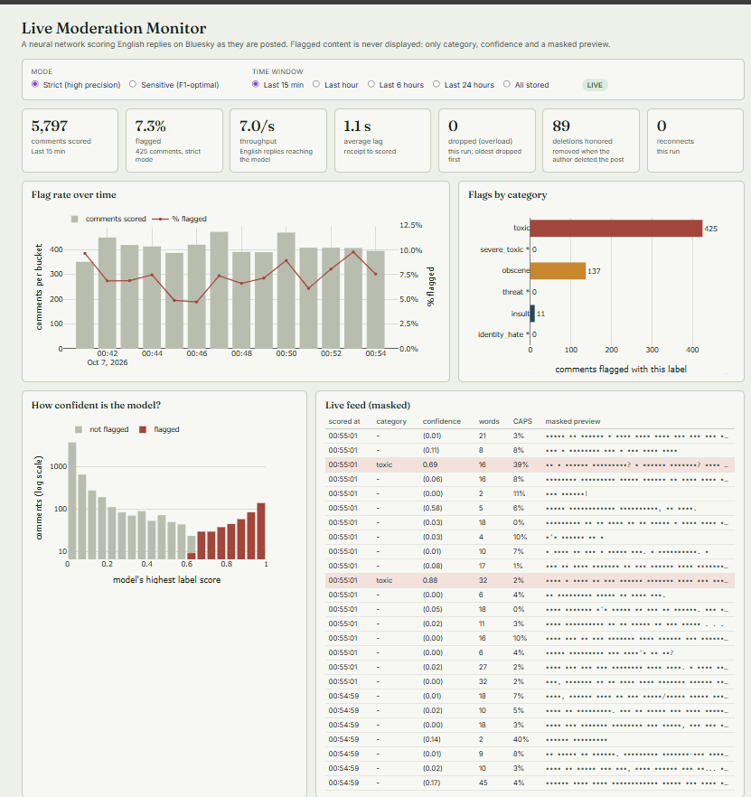

# Real-Time Content Moderation Monitor

*A TensorFlow toxicity classifier scoring live Bluesky replies, with a hand-measured accuracy audit.*



I trained a neural network to flag toxic comments, pointed it at Bluesky's live public stream, and built a dashboard that scores English replies as they are posted. Then I did the step most demos skip: I hand-checked 100 of the model's flags to measure how well a model trained on Wikipedia actually works on Bluesky.

> **This is a portfolio project, not a moderation tool.** Scores are model estimates. Don't use them to take action against anyone.

## The finding: accuracy dropped sharply on new data

On held-out Wikipedia comments, the model's strict mode was **94% precise**. On live Bluesky replies, I reviewed 100 flagged replies by hand, blind to the model's scores:

| What the flagged reply turned out to be | Strict mode (56 reviewed) | Sensitive mode (100 reviewed) |
|---|---|---|
| Abusive: insults, harasses or demeans someone | **27%** (95% CI 17–40%) | 17% (11–26%) |
| Profane, but aimed at no one | 41% | 33% |
| Not toxic (false alarm) | 32% (21–45%) | 50% (40–60%) |
| Abusive *or* profane | 68% (55–79%) | 50% (40–60%) |

What I take from it:

- **The model over-reads tone.** Most strict flags are real offensive language (68%), but fewer than one in three is genuine abuse, and a third are false alarms. In the dashboard's strict-mode view, every flagged comment carried the broad `toxic` label and only about a third also carried `obscene`.
- **The model's confidence still means something.** The 44 replies flagged only in Sensitive mode were 73% false alarms (just 2 abusive), so higher scores really do pick out worse comments. That's why the dashboard defaults to Strict.
- **The flag rate isn't a toxicity rate.** Strict mode flags about 7–8% of English replies. Scaling by the audit, roughly **2% of replies were flagged and confirmed abusive** (range 1.2–2.9%) and about 5% were abusive or profane. These are floors: I did not measure what the model misses.
- **Why it dropped:** the model learned from Wikipedia talk pages. Bluesky replies are shorter, more casual and more sarcastic. The two datasets also define "toxic" differently, so the 68% (abusive or profane) is the fairer comparison with Wikipedia's 94%, and it is still a large gap.

**Caveats.** One reviewer (me), judging each reply without the post it answered. The strict-mode interval is about ±12 points because only 56 flagged replies qualified. It measures precision only, over one session. Full method and counts: [`docs/audit_method_and_results.md`](docs/audit_method_and_results.md).

**What I'd do next:** calibrate the thresholds on labeled Bluesky replies, fine-tune on a few hundred of them, give the model the parent post for context, add a second reviewer to measure agreement, and measure recall with a larger look at unflagged replies.

## How it works

```
Bluesky Jetstream (public WebSocket, no account or API key)
        │  every new post, as JSON
        ▼
Collector (tox_phase3_stream.py)
   keep English replies → clean text → TensorFlow model → 6 label scores
   → two thresholds per label (Strict / Sensitive) → SQLite
        │
        ├──▶ Dashboard (tox_phase4_dashboard.py, Dash): reads SQLite, refreshes live
        └──▶ Optional hand-audit (tox_audit.py): random sample of flagged replies, reviewed blind
```

**The model.** Multi-label (toxic, severe_toxic, obscene, threat, insult, identity_hate) bidirectional LSTM, about 2M parameters, trained for 18 minutes on a laptop CPU. It takes two inputs: the comment text and its uppercase ratio, because my exploration found mostly-CAPS comments were flagged 6.5× as often (59% vs 9%) and Keras' text layer lowercases everything.

**Results on held-out Wikipedia comments** (15,958 comments, never used for tuning):

| Label | Test cases | ROC-AUC | PR-AUC |
|---|---|---|---|
| toxic | 1,544 | 0.976 | 0.878 |
| obscene | 815 | 0.990 | 0.884 |
| insult | 761 | 0.984 | 0.777 |
| severe_toxic | 156 | 0.990 | 0.455 |
| identity_hate | 145 | 0.959 | 0.152 |
| threat | 48 | 0.944 | 0.043 |

The rare labels are weak: ROC-AUC looks excellent because most comments are clean, but PR-AUC shows the real picture (only about 1 in 17 `threat` flags is right at the F1-optimal threshold). Accuracy is deliberately not reported, since a model that flags nothing scores about 90%.

| Operating point (any label flagged) | Precision | Recall |
|---|---|---|
| Sensitive (F1-optimal thresholds) | 82.5% | 77.0% |
| Strict (≥90% validation precision) | 93.7% | 65.0% |

Strict mode can only flag `toxic`, `obscene` and `insult`. The other three labels never reached the precision target, and the dashboard marks them with an asterisk.

**The live pipeline.** In a 10-minute run on the same laptop CPU it scored 8,718 English replies (about 14 per second) with about 1 second average lag, 0 dropped and 0 reconnects. 126 of those posts (1.4%) were deleted by their authors during the run; each was removed from, or never added to, the database.

## Design decisions worth knowing

- **Privacy by design.** The monitoring database never stores post text or account names. It keeps six scores, text length and shape, a hashed post key, and a preview where every character is a bullet. If an author deletes a post on Bluesky, its row is deleted here too, including the case where the delete arrives before the post has been scored. The collector is read-only and never posts, replies or notifies anyone.
- **The audit is opt-in and capped.** `--audit N` keeps the text of at most N randomly chosen flagged replies in a *separate* local file for hand review (reservoir sampling, so every flagged reply has an equal chance). The dashboard never reads it, deleted posts leave it too, and the review tool offers to purge the text when you finish. The review is blind (no scores shown), shuffled, and reports Wilson 95% intervals.
- **Two honest operating points.** Strict and Sensitive thresholds are tuned on validation data only; the test set was used once. The dashboard states each mode's limits.
- **One code path for training and serving.** The same text-cleaning and input-building functions run on the training data and on live posts, so the model sees identically prepared input in both places.
- **Streaming reliability.** A bounded queue drops the *oldest* waiting posts under overload (and counts them); the connection reconnects with exponential backoff, rotates between Bluesky's two servers, and replays missed events only after a short gap. A mid-run laptop sleep showed the reconnect logic working unaided; I then hardened it so that after a long gap it rejoins live instead of replaying hours of old posts under the wrong timestamps.
- **A dashboard that agrees with itself.** Each refresh runs every query inside one read transaction, so all panels describe the same set of comments. Outages show up as gaps, not as a line quietly bridging them.
- **Why Bluesky, not Reddit.** I planned to use Reddit, but its unauthenticated JSON endpoints were shut off in May 2026 and API access now needs pre-approval. Bluesky's Jetstream is open and needs no account.

## Run it yourself

Needs Python 3.10+ and an internet connection. No API keys or accounts. Developed on Windows with CPU-only TensorFlow.

```bash
git clone https://github.com/Setu1392/bluesky-moderation-monitor.git
cd bluesky-moderation-monitor
python -m venv .venv
.venv\Scripts\activate          # macOS/Linux: source .venv/bin/activate
pip install -r requirements.txt
```

The trained model is included in `models/` (about 8 MB), so you can go straight to step 3. To retrain it yourself, do steps 1–2.

| Step | Command | What it does |
|---|---|---|
| 1 | `python tox_phase1_explore_preprocess.py` | Downloads the dataset (69 MB), explores it with SQL, cleans and splits it |
| 2 | `python tox_phase2_train.py` | Trains and evaluates the model (about 18 min on CPU). Add `--smoke` first for a 1-minute dry run |
| 3 | `python tox_phase3_stream.py --probe` | 15-second network check; nothing stored |
| 3 | `python tox_phase3_stream.py --selftest` | Offline end-to-end test of the pipeline |
| 3 | `python tox_phase3_stream.py` | Runs the live collector until Ctrl+C |
| 4 | `python tox_phase4_dashboard.py` | Dashboard at http://127.0.0.1:8050 (run it in a second terminal) |
| 4 | `python tox_phase4_dashboard.py --check` | Builds every panel once and validates it |
| opt. | `python tox_phase3_stream.py --audit 100`, then `python tox_audit.py` | Collect and hand-review a sample of flagged replies |

## What's in the repo

| File | Purpose |
|---|---|
| `tox_common.py`, `tox_scoring.py` | Shared text cleaning, input building and scoring |
| `tox_phase1_explore_preprocess.py` | Data download, SQL exploration, cleaning, stratified split |
| `tox_phase2_train.py` | Model, training, threshold tuning, evaluation |
| `tox_phase3_stream.py` | Live collector: Jetstream client, scoring, SQLite logging |
| `tox_phase4_dashboard.py` | Dash dashboard |
| `tox_audit.py` | Hand-audit sampler, blind review tool, statistics |
| `models/` | Trained model, tuned thresholds, evaluation metrics |
| `audit_summary.json` | Audit results (counts and rates only, no text) |
| `docs/` | Audit method and results, screenshots |

## Data and acknowledgements

- **Training data:** the Jigsaw Toxic Comment Classification Challenge (about 160,000 Wikipedia talk-page comments), via [this Hugging Face mirror](https://huggingface.co/datasets/thesofakillers/jigsaw-toxic-comment-classification-challenge). Labels are CC0; the comment text is governed by Wikipedia's CC-BY-SA license.
- **Live data:** public posts from Bluesky's [Jetstream](https://bsky.network/docs/jetstream) service. Only derived scores are kept; no post text or account names are stored.
- Built with TensorFlow/Keras, pandas, scikit-learn, SQLite and Dash.

*Setu Patel · October 2026*
